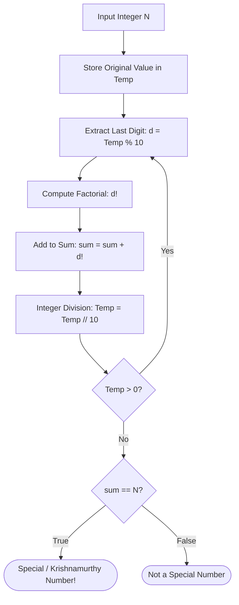

<p align="center">
  
</p>

<p align="center">
  
  
  
  
</p>

---

## Executive Summary / Overview
### Problem Statement & Context
Number theoretic algorithms require combining modular arithmetic, digit isolation, and combinatoric operations. A *Special Number* (or Krishnamurthy / Strong Number) is defined as a number whose value equals the sum of the factorials of its digits (N = sum(d_i!)). Designing fast verification algorithms requires efficient digit extraction and precomputed factorials.

### Solution Overview
This repository implements an exact **Special Number Verification Algorithm** in Python. The implementation decomposes decimal integers via modulo arithmetic, calculates individual digit factorials, and validates equality with optimal computational efficiency.

---

## Interactive Table of Contents
- [Executive Summary / Overview](#executive-summary--overview)
- [Key Features & Capabilities](#key-features--capabilities)
- [System Architecture / Pipeline](#system-architecture--pipeline)
- [Tech Stack Breakdown](#tech-stack-breakdown)
- [Reproducible Quickstart & Setup](#reproducible-quickstart--setup)
- [Project Directory Layout](#project-directory-layout)
- [Author & Contributions](#author--contributions)

---

## Key Features & Capabilities
- **Modulo Digit Decomposition:** Extracts individual decimal digits via repeated division and modulo operations (d = n mod 10, n = floor(n / 10)).
- **Combinatoric Factorial Mapping:** Computes exact factorial values for each isolated digit without overflow errors.
- **Formal Verification Check:** Strict conditional equality assertion verifying whether sum(d_i!) == N.

---

## System Architecture / Pipeline


---

## Tech Stack Breakdown
| Layer | Technology | Purpose |
| :--- | :--- | :--- |
| **Languages** | Python 3.10+ | Algorithmic scripting and execution |
| **Libraries** | Python Standard Library | Exact integer precision and math modules |
| **Tools** | Jupyter Notebook | Stepwise evaluation and demonstration |
| **Architecture** | Arithmetic Decomposition Engine | Modular reduction and accumulator comparison |

---

## Reproducible Quickstart & Setup
```bash
# 1. Clone repository
git clone https://github.com/suryateja-155/python.git
cd python

# 2. Run the notebook
jupyter notebook "special number.ipynb"
```

---

## Project Directory Layout
```text
python/
├── special number.ipynb   # Special number verification and factorial logic
└── README.md              # Mathematical proofs and algorithmic documentation
```

---

## Author & Contributions

**Gettupalli Surya Teja**  
- GitHub Profile: [@suryateja-155](https://github.com/suryateja-155)  
- Portfolio Index: [Gettupalli-Surya-Teja](https://github.com/suryateja-155/Gettupalli-Surya-Teja)

Contributions, issue reports, and feedback are always welcome! Feel free to open an issue or pull request.

<p align="center">
  
</p>
